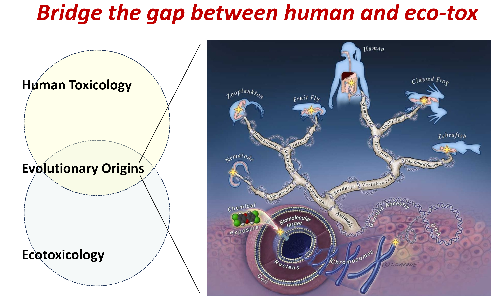

## Welcome to the Systems Hazard Assessment & Risk Prediction (SHARP) Lab

## *From hidden clues to elegant views.*

<table class="cover-gallery">
<tr valign="top">

<td align="center" width="20%">
   
  

    ES&amp;T Front Cover 
    (2016 Best Paper Second Runner Up)
  

</td>

<td align="center" width="20%">
   
  

    Functional Genomics Screening 
    of Air Pollutants
  

</td>

<td align="center" width="20%">
   
  

    Transcriptomics Assessment 
    of Mixtures
  

</td>

<td align="center" width="20%">
   
  

    Network Modeling 
    for Toxicity Prediction
  

</td>

<td align="center" width="20%">
   
  

    Climate-Informed 
    One Health Toxicology
  

</td>

</tr>
</table>